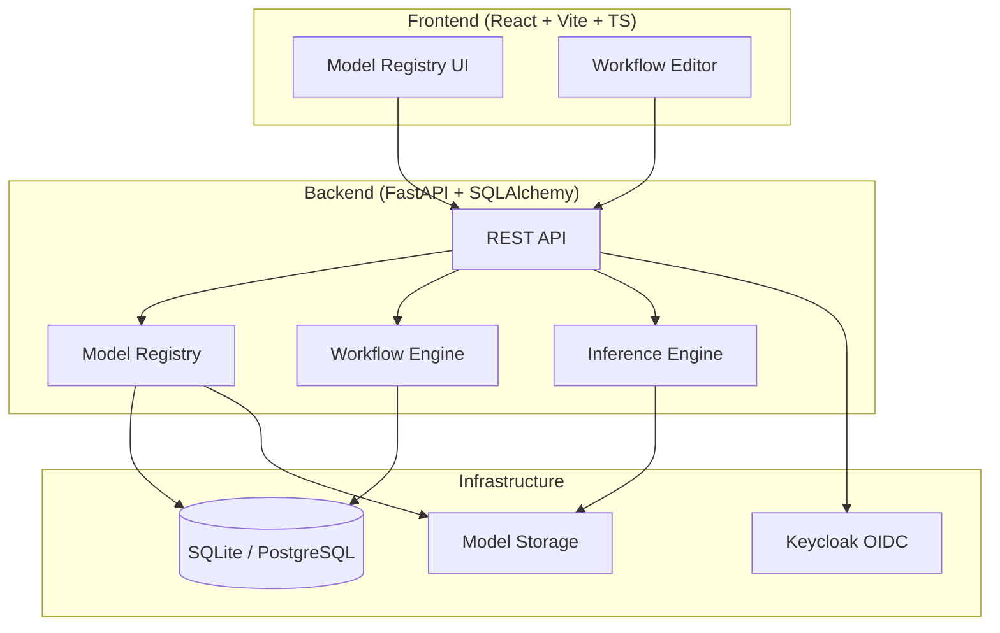

# Axiom Workbench — Alan Vo

Current version: `1.0.0`.

**Axiom Workbench** — Alan Vo | AI & Machine Learning

A powerful, modular diffusion model workbench with a graph/nodes interface and fast local inference engine. Built for AI/ML developers and researchers who need reproducible, controllable diffusion workflows.

## The Problem

Diffusion model workflows today are fragmented across multiple tools: model management in file explorers, prompt engineering in text editors, workflow composition in node graphs, and inference across different backends. Existing solutions either lack programmatic APIs (ComfyUI), require cloud dependencies, or don't provide reproducible model versioning and VRAM-aware execution.

## The Approach

Axiom Workbench provides a unified platform with:

- **Model Registry**: Centralized model metadata with versioning, SHA256 verification, and architecture tagging
- **Graph/Nodes Workflow Editor**: Visual DAG composer for diffusion pipelines (planned)
- **Local Inference Engine**: Fast, VRAM-aware execution with safetensors loading, Euler/DPM samplers, FLUX/SDXL support (planned)
- **OIDC Authentication**: Keycloak-backed SSO with RBAC (planned)
- **LLM Prompt Enhancement**: Multi-provider adapters for prompt optimization (planned)

## Quick Start

### Prerequisites

- Docker 24+ and Docker Compose v2
- Node 24+ (for frontend development)
- Python 3.12+ (for backend development)

### With Docker Compose (Recommended)

```bash
git clone https://github.com/ALANDVO/axiom-workbench-alan-vo
cd axiom-workbench-alan-vo
docker compose up -d --build
```

Services will be available at:
- **Frontend**: http://localhost
- **Backend API**: http://localhost:8000
- **API Docs**: http://localhost:8000/docs
- **Keycloak**: http://localhost:8080 (admin/admin)

### Local Development

**Backend:**
```bash
cd backend
python -m venv .venv
.venv/bin/pip install -r requirements.txt
.venv/bin/python -m uvicorn app.main:app --reload
```

**Frontend:**
```bash
cd frontend
npm install
npm run dev
```

### Run Tests

**Backend:**
```bash
cd backend
.venv/bin/python -m pytest tests/ -v
```

**Frontend:**
```bash
cd frontend
npm test
```

## Architecture



## API Reference

### Model Registry

| Method | Endpoint | Description |
|--------|----------|-------------|
| POST | `/api/v1/models` | Register a new model |
| GET | `/api/v1/models` | List models (paginated, filterable) |
| GET | `/api/v1/models/{id}` | Get model by ID |
| PATCH | `/api/v1/models/{id}` | Update model |
| DELETE | `/api/v1/models/{id}` | Delete model |
| POST | `/api/v1/models/{id}/versions` | Add model version |
| GET | `/api/v1/models/{id}/versions` | List model versions |

**Example: Register a model**
```bash
curl -X POST http://localhost:8000/api/v1/models \
  -H "Content-Type: application/json" \
  -d '{
    "name": "flux-dev",
    "display_name": "FLUX.1 Dev",
    "architecture": "flux",
    "format": "safetensors",
    "file_path": "/models/flux-dev.safetensors",
    "file_size": 23000000000,
    "hash_sha256": "a1b2c3d4..."
  }'
```

### Health Check

```bash
curl http://localhost:8000/health
```

## Configuration

Copy `.env.example` to `.env` and adjust:

```bash
cp .env.example .env
```

| Variable | Description | Default |
|----------|-------------|---------|
| `DATABASE_URL` | SQLAlchemy async URL | `sqlite+aiosqlite:///./axiom.db` |
| `SECRET_KEY` | JWT secret (min 32 chars) | **Required in production** |
| `CORS_ORIGINS` | Allowed CORS origins | `["http://localhost:5173"]` |
| `MODELS_DIR` | Model storage path | `/app/models` |
| `KEYCLOAK_URL` | Keycloak base URL | — |
| `LLM_PROVIDER` | LLM provider (openai/anthropic/gemini/ollama) | — |

## Security

- **No hardcoded secrets** — all credentials via environment variables
- **OIDC with PKCE** — authorization code flow with Keycloak (planned)
- **HttpOnly cookies** — CSRF-protected session management (planned)
- **Role-based access** — viewer/operator/admin roles (planned)
- **Input validation** — Pydantic schemas on all endpoints

### Production Checklist

- [ ] Set strong `SECRET_KEY` (32+ chars)
- [ ] Use PostgreSQL instead of SQLite
- [ ] Configure Keycloak realm and client
- [ ] Enable TLS via reverse proxy (nginx/Traefik)
- [ ] Set `ENVIRONMENT=production` and `DEBUG=false`
- [ ] Restrict `CORS_ORIGINS` to your domain
- [ ] Configure backup/restore for model storage and database

## AI/ML Evaluation

This product implements a **diffusion model workflow orchestration platform**. Evaluation focuses on:

- **Model loading latency** (cold vs warm cache)
- **VRAM utilization efficiency** across model sizes
- **Inference throughput** (iterations/second) for FLUX, SDXL, SD3
- **Workflow graph execution correctness** and determinism

**Baseline**: ComfyUI reference workflows on identical hardware (RTX 3060 12GB / RTX 4090 24GB).

**Reproducible benchmark command** (planned):
```bash
python -m benchmark --model flux-dev --steps 20 --batch 4 --runs 5
```

Results will be documented in `docs/evaluation.md` with:
- Hardware specifications
- Model variants tested
- Measured latency (p50, p95, p99)
- VRAM peak/average
- Failure cases and limitations

## Development

### Project Structure

```
axiom-workbench-alan-vo/
├── backend/
│   ├── app/
│   │   ├── api/          # API routes
│   │   ├── models/       # SQLAlchemy models
│   │   ├── core/         # Config, database
│   │   └── services/     # Business logic
│   ├── tests/            # Pytest tests
│   ├── requirements.txt
│   └── Dockerfile
├── frontend/
│   ├── src/
│   │   ├── api/          # Typed API client
│   │   ├── components/   # React components
│   │   ├── pages/        # Page components
│   │   ├── types/        # TypeScript types
│   │   └── __tests__/    # Vitest tests
│   ├── package.json
│   ├── vite.config.ts
│   └── Dockerfile
├── compose.yaml
├── .github/workflows/ci.yml
├── portfolio.json
└── README.md
```

### Adding a New Feature

1. Create feature branch: `git checkout -b feature/xyz`
2. Update `feature-plan.json` with new feature
3. Implement backend API + tests
4. Implement frontend components + tests
5. Update `README.md` and `CHANGELOG.md`
6. Run full test suite: `make test` (or equivalent)
7. Submit PR

## License

MIT License — Copyright (c) 2026 Alan Vo <alanvo@gmail.com>

See [LICENSE](LICENSE) for details.